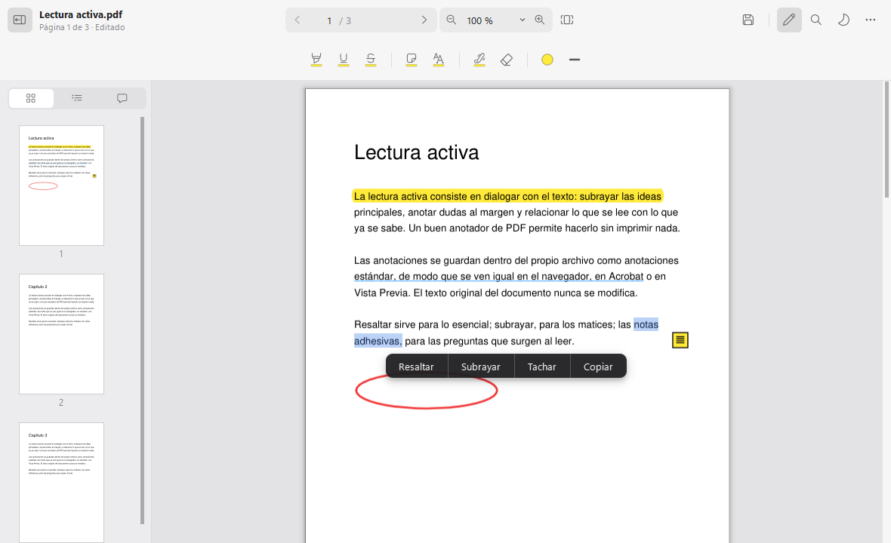

# Anotador PDF

[](https://github.com/bamdab7/anotador-pdf/actions/workflows/tests.yml)
[](LICENSE)
[](https://github.com/bamdab7/anotador-pdf/releases/latest)

Aplicación de escritorio para Windows que abre PDFs y permite **anotarlos**: resaltar,
subrayar, tachar, añadir notas adhesivas y cuadros de texto, y dibujar a mano alzada (con
ratón o lápiz táctil). Su diseño está inspirado en Papers, el visor de GNOME, y en Vista
Previa de macOS.

Las anotaciones se guardan como **anotaciones PDF estándar**, así que se ven igual en el
navegador, en Acrobat o en cualquier otro lector. El texto original del documento nunca
se modifica.



<details>
<summary>Modo oscuro y modo noche</summary>


</details>

## Funciones

- **Lectura:** scroll continuo, zoom, miniaturas, índice del documento, búsqueda con
  «3 de 12» y modo noche (página oscura conservando los colores de los resaltados).
- **Anotar:** resaltar, subrayar y tachar texto (también desde una mini barra que aparece
  al seleccionar), notas adhesivas, cuadros de texto y dibujo con lápiz y goma. Las notas
  y los cuadros se pueden mover, editar y borrar.
- **Lista de anotaciones** en el panel lateral, para saltar a cualquiera.
- **Deshacer y rehacer** (Ctrl+Z / Ctrl+Y) para todo.
- **Guardar** solo cuando tú lo pides, y aviso al cerrar si hay cambios sin guardar.
- **Barras de herramientas personalizables**, archivos recientes, tema claro u oscuro
  según Windows.
- **Abrir PDFs con doble clic** desde el Explorador y **actualizaciones con un clic**
  desde la propia app.

## Instalación

Para usarlo no hace falta instalar Python ni nada más: descarga `AnotadorPDF.exe` de la
[última versión](https://github.com/bamdab7/anotador-pdf/releases/latest) y ábrelo. Es un
único archivo con todo dentro.

👉 **[Guía de instalación paso a paso](INSTALAR.md)**, pensada para quien no tenga
experiencia: incluye cómo abrir los PDF con doble clic, cómo actualizar y cómo
desinstalar.

Requisitos: Windows 10 u 11 de 64 bits.

### Actualizar

En la app: menú **⋯ › Buscar actualizaciones…**. Si hay una versión nueva, se descarga,
se instala y la app se vuelve a abrir. La app solo se conecta a Internet cuando pulsas
ese botón.

## Desarrollo

Requisitos: Windows, [Python](https://www.python.org/downloads/) 3.11 o superior y git.

```powershell
git clone https://github.com/bamdab7/anotador-pdf.git
cd anotador-pdf
py -m venv .venv
.venv\Scripts\python.exe -m pip install -r requirements-dev.txt

.venv\Scripts\python.exe main.py          # ejecutar la app
.venv\Scripts\python.exe -m pytest        # tests
.venv\Scripts\python.exe tools\build_exe.py  # crear el .exe (en dist\)
```

Se usa `.venv\Scripts\python.exe` directamente, en vez de activar el entorno, porque la
política de scripts de PowerShell suele bloquear `Activate.ps1`.

### Estructura

| Carpeta | Contenido |
|---|---|
| `main.py` | Punto de entrada. Acepta un PDF como argumento (así lo abre Windows al hacer doble clic). |
| `anotador/core/` | Lógica sin interfaz: leer y anotar PDFs con [PyMuPDF](https://pymupdf.readthedocs.io), historial, búsqueda, geometría. **Sin imports de Qt**, para poder probarla con pytest. |
| `anotador/ui/` | Ventanas y widgets de Qt ([PySide6](https://doc.qt.io/qtforpython-6/)). Llama a `core`, nunca a PyMuPDF directamente. |
| `tests/` | Tests de `core`. Los PDFs de prueba se generan dentro de cada test. |
| `tools/build_exe.py` | Crea el .exe con PyInstaller. |
| `.github/workflows/` | Tests en cada push, y publicación de versiones. |

Algunas decisiones de diseño:

- **Anotaciones estándar:** todo se crea con `page.add_*_annot` de PyMuPDF; nunca se dibuja
  encima de la página ni se «aplana».
- **Coordenadas:** la pantalla usa píxeles y el PDF puntos (72 por pulgada). La conversión
  según el zoom está en un solo sitio (`core/geometry.py`). En las páginas rotadas se usan
  las matrices de rotación de PyMuPDF.
- **Deshacer** usa el registro de cambios («journal») de MuPDF. Ese registro deja de ser
  fiable al guardar, así que el documento se reabre tras cada guardado (ver
  `core/document.py`).
- **Interfaz en español; código (variables, funciones, clases) en inglés.**

### Probar el .exe sin pantalla

```powershell
$env:QT_QPA_PLATFORM = "offscreen"
$env:ANOTADOR_SETTINGS_DIR = "$env:TEMP\anotador-prueba"   # no tocar tus preferencias
dist\AnotadorPDF.exe ejemplo.pdf --screenshot captura.png
```

`ANOTADOR_SETTINGS_DIR` hace que las preferencias se guarden en un archivo de esa carpeta
en lugar del registro de Windows; también sirve para llevar la app en un USB.

## Publicar una versión

1. Sube el número en `anotador/__init__.py` (`__version__ = "1.1.0"`) y haz commit.
2. Crea y sube la etiqueta con el mismo número:
   ```powershell
   git tag v1.1.0
   git push origin main --tags
   ```
3. GitHub Actions comprueba que la etiqueta coincide con `__version__`, pasa los tests,
   crea el .exe, lo prueba abriendo un PDF y publica la versión en
   [Releases](https://github.com/bamdab7/anotador-pdf/releases) con el archivo
   `AnotadorPDF.exe`. Puedes editar después la descripción de la versión: es
   lo que verá la gente en «Buscar actualizaciones».

Las actualizaciones desde la app solo funcionan si el repositorio es **público**: la app
consulta la API de GitHub sin iniciar sesión.

## Licencia

[GNU AGPL v3.0](LICENSE). Puedes usar, estudiar, modificar y compartir el programa; si
distribuyes una versión modificada, tienes que publicar también su código con la misma
licencia.

Se eligió la AGPL porque la usa [PyMuPDF](https://github.com/pymupdf/PyMuPDF) (AGPL v3 o
licencia comercial de Artifex), de la que depende la app. Además usa
[Qt for Python / PySide6](https://www.qt.io/qt-for-python) (LGPL v3) y
[NumPy](https://numpy.org) (BSD). Los iconos son los de la fuente Segoe Fluent Icons que
incluye Windows; la app no los distribuye.
