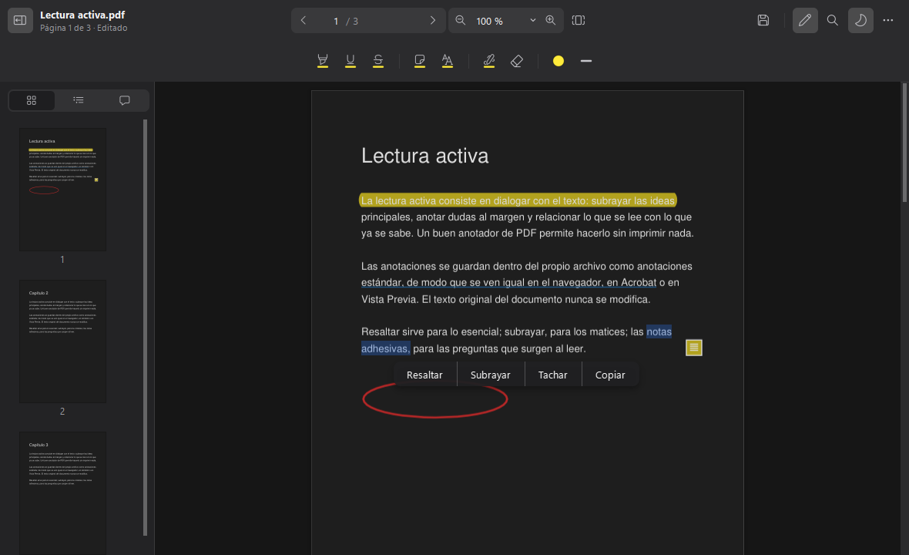

# Anotop.at

[](https://github.com/bamdab7/anotop.at/actions/workflows/tests.yml)
[](LICENSE)
[](https://github.com/bamdab7/anotop.at/releases/latest)

**Anotop.at** es una aplicación de escritorio para Windows que abre documentos PDF y
permite **anotarlos**: resaltar, subrayar y tachar texto, añadir notas adhesivas y
cuadros de texto, y dibujar a mano alzada con ratón o lápiz táctil. Su diseño se inspira
en Papers, el visor de documentos de GNOME, y en Vista Previa de macOS.

Las anotaciones se guardan como **anotaciones PDF estándar**, de modo que se ven igual en
el navegador, en Acrobat o en cualquier otro lector. El texto original del documento no
se modifica nunca.

> Hasta la versión 1.1.0 el proyecto se llamaba «Anotador PDF».


<details>
<summary>Modo oscuro y modo noche</summary>


</details>

## Funciones

- **Lectura:** scroll continuo, zoom, miniaturas, índice del documento, búsqueda con
  contador de resultados («3 de 12») y modo noche, que oscurece la página sin alterar los
  colores de los resaltados. El modo noche solo cambia cómo se ve el documento en la app:
  el archivo PDF no se modifica y se sigue viendo con sus colores originales en otros
  lectores.
- **Anotaciones:** resaltar, subrayar y tachar texto (también desde una mini barra que
  aparece al seleccionarlo), notas adhesivas, cuadros de texto y dibujo con lápiz y goma.
  Las notas y los cuadros se pueden mover, editar y borrar.
- **Lista de anotaciones** en el panel lateral, para saltar a cualquiera de ellas.
- **Deshacer y rehacer** cualquier cambio.
- **El PDF solo se guarda cuando se pulsa Guardar**, y la app avisa al cerrar si quedan
  cambios sin guardar.
- **Diseño claro u oscuro** según el tema de Windows, con barras de herramientas
  personalizables y lista de archivos recientes.
- **Integración con Windows:** abrir los PDF con doble clic desde el Explorador y
  actualizar la app con un clic desde el menú **⋯ › Buscar actualizaciones…**. La app
  solo se conecta a Internet al buscar actualizaciones.

Las novedades de cada versión están en **[CHANGELOG.md](CHANGELOG.md)**.

### Atajos de teclado

| Acción | Atajo |
|---|---|
| Abrir · Guardar · Guardar como | Ctrl+O · Ctrl+S · Ctrl+Mayús+S |
| Deshacer · Rehacer | Ctrl+Z · Ctrl+Y |
| Buscar | Ctrl+F (F3 / Mayús+F3 para el siguiente o el anterior) |
| Acercar · Alejar · Tamaño real · Ajustar al ancho | Ctrl++ · Ctrl+− · Ctrl+0 · Ctrl+2 |
| Página anterior · siguiente | Ctrl+RePág · Ctrl+AvPág |
| Mostrar u ocultar las herramientas de marcación | Ctrl+Mayús+A |
| Panel lateral | F9 |
| Modo noche | Ctrl+I |
| Barra de menús clásica | Ctrl+M |

## Instalación

No hace falta instalar Python ni ningún otro programa: basta con descargar
`Anotop.at.exe` de la [última versión](https://github.com/bamdab7/anotop.at/releases/latest)
y abrirlo. Es un único archivo que lo incluye todo.

👉 **[Guía de instalación paso a paso](INSTALAR.md)**, pensada para personas sin
experiencia: explica también cómo abrir los PDF con doble clic, cómo actualizar y cómo
desinstalar.

Requisitos: Windows 10 u 11 de 64 bits.

## Desarrollo

Se necesita Windows, [Python](https://www.python.org/downloads/) 3.11 o superior y git.

```powershell
git clone https://github.com/bamdab7/anotop.at.git
cd anotop.at
py -m venv .venv
.venv\Scripts\python.exe -m pip install -r requirements-dev.txt

.venv\Scripts\python.exe main.py             # ejecutar la app
.venv\Scripts\python.exe -m pytest           # tests
.venv\Scripts\python.exe tools\build_exe.py  # crear dist\Anotop.at.exe
```

Se llama a `.venv\Scripts\python.exe` directamente, en lugar de activar el entorno,
porque la política de scripts de PowerShell suele bloquear `Activate.ps1`.

### Estructura

| Carpeta | Contenido |
|---|---|
| `main.py` | Punto de entrada. Acepta un PDF como argumento (así lo abre Windows al hacer doble clic). |
| `anotador/core/` | Lógica sin interfaz: leer y anotar PDFs con [PyMuPDF](https://pymupdf.readthedocs.io), historial, búsqueda, geometría y actualizaciones. **Sin imports de Qt**, para poder probarla con pytest. |
| `anotador/ui/` | Ventanas y widgets de Qt ([PySide6](https://doc.qt.io/qtforpython-6/)). Llama a `core`, nunca a PyMuPDF directamente. |
| `tests/` | Tests de `core`. Los PDFs de prueba se generan dentro de cada test. |
| `tools/` | Creación del .exe con PyInstaller y notas de cada versión. |
| `.github/workflows/` | Tests en cada push y publicación de versiones. |

El paquete de Python conserva el nombre `anotador`, de antes del cambio de nombre.

### Decisiones de diseño

- **Anotaciones estándar:** todo se crea con `page.add_*_annot` de PyMuPDF; nunca se
  dibuja encima de la página ni se «aplana».
- **Coordenadas:** la pantalla usa píxeles y el PDF puntos (72 por pulgada). La conversión
  según el zoom está en un solo sitio (`core/geometry.py`). En las páginas rotadas se usan
  las matrices de rotación de PyMuPDF.
- **Deshacer** usa el registro de cambios («journal») de MuPDF. Ese registro deja de ser
  fiable al guardar, así que el documento se reabre tras cada guardado (ver
  `core/document.py`).
- **Interfaz en español; código (variables, funciones, clases) en inglés.**

### Probar el .exe sin pantalla

```powershell
$env:QT_QPA_PLATFORM = "offscreen"
$env:ANOTADOR_SETTINGS_DIR = "$env:TEMP\anotop-prueba"   # no toca las preferencias reales
dist\Anotop.at.exe ejemplo.pdf --screenshot captura.png
```

Con `ANOTADOR_SETTINGS_DIR`, las preferencias se guardan en un archivo de esa carpeta en
lugar del registro de Windows. También sirve para llevar la app en un USB.

### Publicar una versión

Las versiones se publican automáticamente con GitHub Actions al subir una etiqueta
`vX.Y.Z`, y cada una lleva en su descripción las novedades escritas en `CHANGELOG.md`.
Los pasos están en **[docs/PUBLICAR.md](docs/PUBLICAR.md)**.

## Licencia

[GNU AGPL v3.0](LICENSE). El programa se puede usar, estudiar, modificar y compartir;
quien distribuya una versión modificada debe publicar también su código con la misma
licencia.

Se eligió la AGPL porque es la licencia de [PyMuPDF](https://github.com/pymupdf/PyMuPDF)
(AGPL v3 o licencia comercial de Artifex), de la que depende la app. Además usa
[Qt for Python / PySide6](https://www.qt.io/qt-for-python) (LGPL v3) y
[NumPy](https://numpy.org) (BSD). Los iconos son los de la fuente Segoe Fluent Icons
incluida en Windows; la app no los distribuye.
